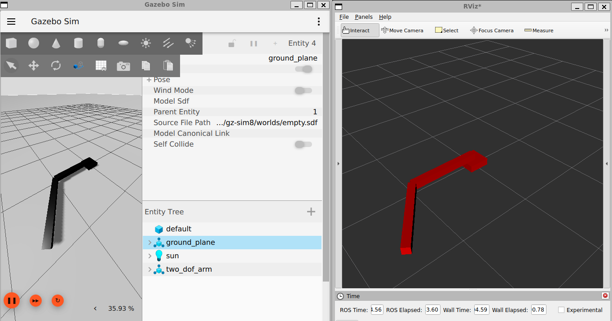
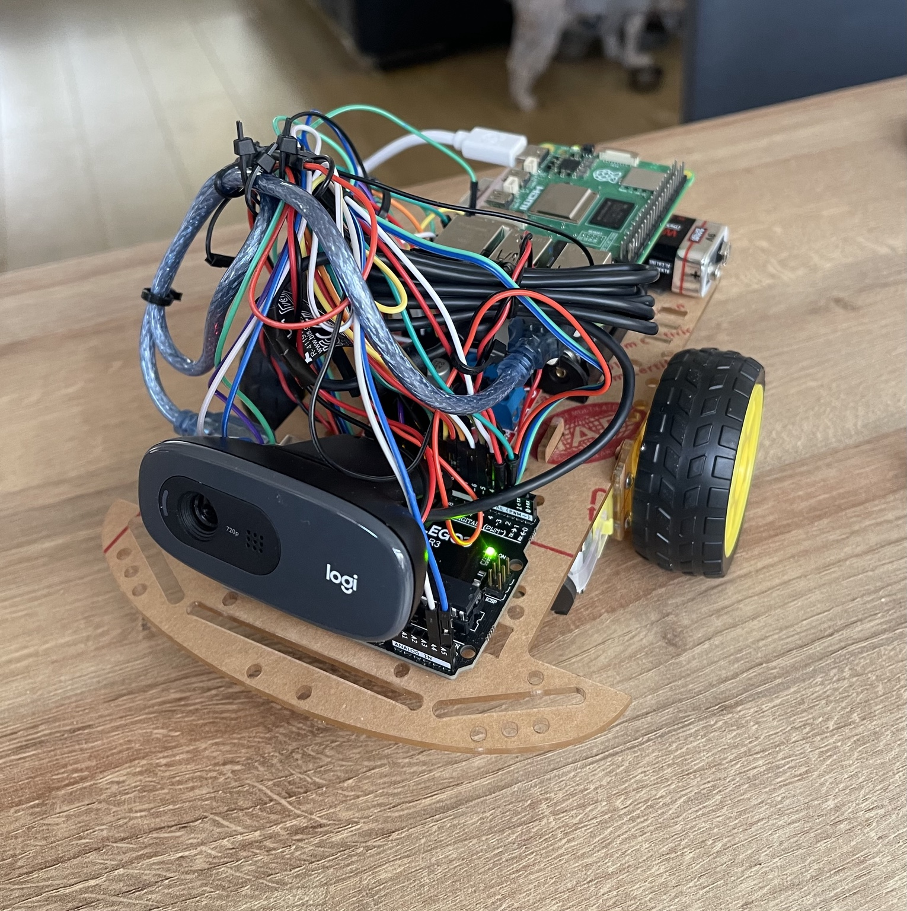

# Robotics Engineering Portfolio

A portfolio of robotics engineering projects covering embedded systems, control, ROS 2, perception, autonomous systems and robot integration.

This repository contains selected projects developed through my robotics engineering roadmap and ROS 2 development work. Each project includes the engineering approach, system architecture, implementation, testing, results and source code.

---

## Featured Projects

### 1. Encoder-Feedback Differential-Drive Mobile Robot

Autonomous differential-drive mobile robot featuring:

- Dual quadrature encoder feedback
- Independent PI wheel-speed control
- Differential-drive kinematics
- Encoder-based odometry
- HC-SR04 ultrasonic obstacle detection
- MPU6050 accelerometer and gyroscope
- Autonomous obstacle avoidance
- Encoder-measured ~90° turning

**Technologies:** Arduino • C++ • Embedded Systems • Motor Control • Encoders • PI Control • Odometry • Sensor Integration

[View Project →](project-1-differential-drive-robot/)

---

### 2. ROS 2 Robot Arm Kinematics, Simulation and Control

Simulation-based 2-DOF robot arm using ROS 2, Gazebo, RViz and `ros2_control`, with forward/inverse kinematics, joint trajectory control and ROS 2 integration.

**Key skills:** ROS 2 · Gazebo · RViz · ros2_control · URDF · FK/IK · Jacobians · Trajectory Control

### [View Full Project →](project-2-ros2-robot-arm/)

---

### 3. Vision-Enabled Mobile Robot with YOLO Tracking & Visual SLAM

Developed a physical vision-enabled robot using a Raspberry Pi 5, YOLO11 Nano and Arduino-based motor control. Implemented rotation-only object tracking, tested continuous and pulse-based steering, and integrated MPU-6050 gyroscope measurements.

A separate ROS 2 Jazzy and Gazebo simulation demonstrates RGB-D visual SLAM using RTAB-Map.

**Key skills:** Computer Vision · YOLO · Raspberry Pi · Arduino · Motor Control · ROS 2 · Gazebo · RTAB-Map

[View Project →](project-3-vision-enabled-mobile-robot/)

---
---

## Portfolio Structure

This portfolio will include:

- 4 major robotics engineering projects
- 2–3 ROS 2 projects
- Embedded systems and control
- Robot perception
- Mobile robotics
- Manipulation
- Autonomous robotics

Each project is documented with source code, architecture, experimental results and engineering analysis.
