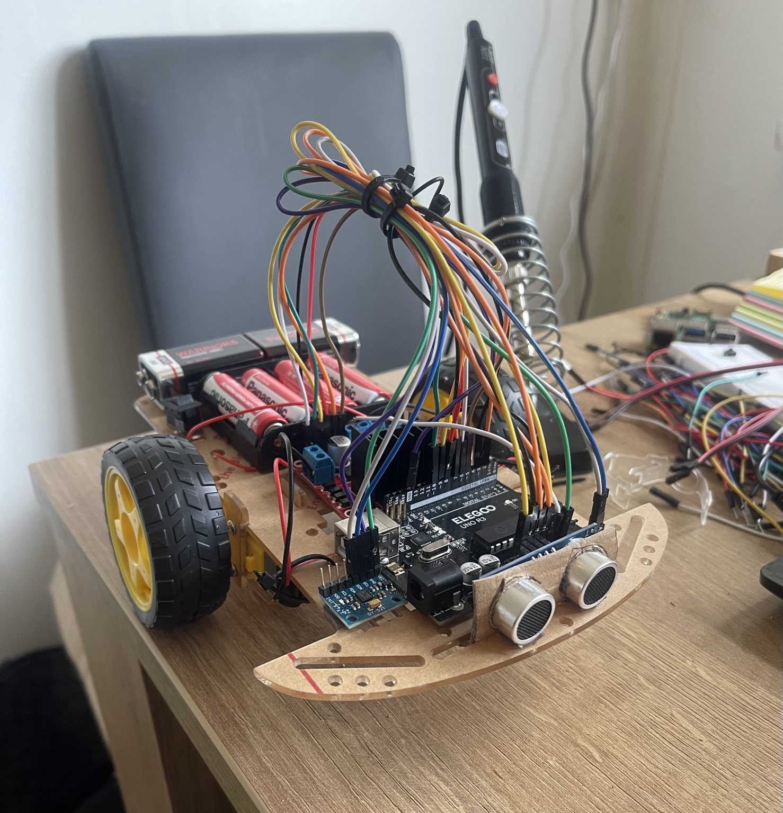
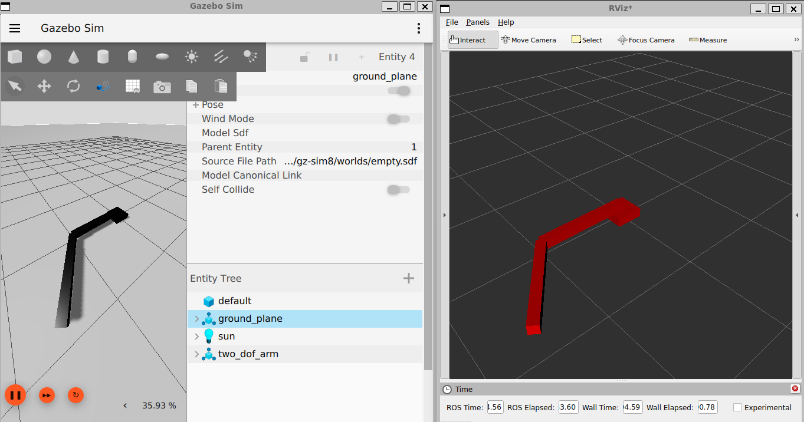
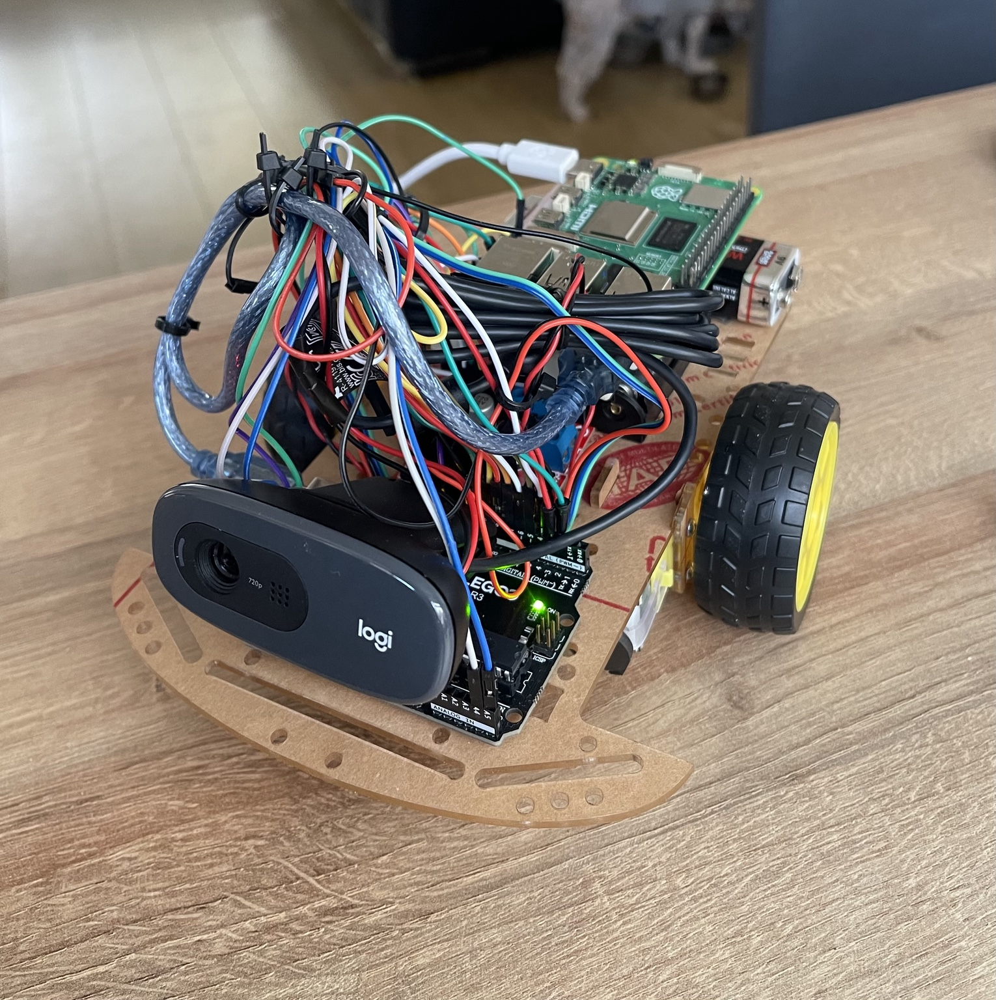
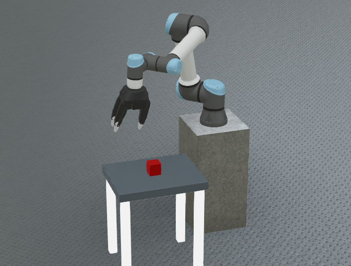
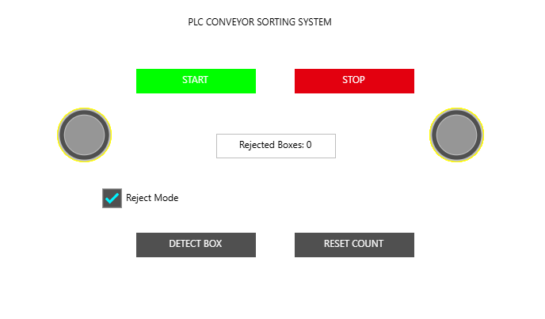

# Robotics Engineering Portfolio

A portfolio of robotics and automation projects spanning ROS 2 software engineering, autonomous mobile robotics, robot control, computer vision, embedded systems, simulation, and industrial automation.

The projects demonstrate practical engineering experience across software development, system integration, testing, debugging, control, perception, and autonomous robotic systems.

---

## ROS 2 Software Engineering Projects

### 1. ROS 2 Project 1 — Motor Health Monitoring System

**ROS 2 Jazzy · Python · rclpy · QoS · Parameters · Services · Launch · Testing**

Built a ROS 2 motor temperature monitoring system featuring publisher/subscriber communication, runtime-configurable parameters, custom QoS, a reset service, launch files, namespaces, topic remapping, logging, and automated testing.

```bash
ros2 param set /robot1/temperature_subscriber warning_threshold 50.0
# Motor normal: 47.8 C

ros2 service call /reset_warning_threshold std_srvs/srv/Trigger
# MOTOR HOT: 47.8 C
```

[View Project →](./00-ros2-project-1-motor-health-monitoring)

---

## Robotics & Automation Projects

### 1. Encoder-Feedback Differential-Drive Mobile Robot

Designed and built a differential-drive mobile robot featuring independent PI wheel-speed control using quadrature encoder feedback. Implemented encoder-based odometry, ultrasonic obstacle avoidance and MPU-6050 sensing, with experimental testing of robot movement and turning accuracy.



**Key Skills & Technologies:** Arduino · C++ · Embedded Systems · PI Control · Motor Drivers · Quadrature Encoders · Odometry · Sensor Integration

[View Full Project →](project-1-differential-drive-robot/)

---

### 2. ROS 2 Robot Arm — Kinematics, Simulation & Control

Developed a simulation-based 2-DOF robotic arm using ROS 2, Gazebo and RViz. Implemented forward and inverse kinematics, Jacobian-based analysis, joint trajectory control and `ros2_control` integration to simulate and control arm movement.



**Key Skills & Technologies:** ROS 2 · Python · Gazebo · RViz · URDF · Forward/Inverse Kinematics · Jacobians · ros2_control · Joint Trajectories

[View Full Project →](project-2-ros2-robot-arm/)

---

### 3. Vision-Enabled Mobile Robot — YOLO Tracking & Visual SLAM

Built a vision-enabled mobile robot using a Raspberry Pi 5, YOLO11 Nano and Arduino Uno for real-time, rotation-only object tracking. Developed and tested continuous and pulse-based steering controllers, integrated MPU-6050 gyroscope measurements, and implemented a separate RGB-D visual SLAM simulation using ROS 2, Gazebo and RTAB-Map.



**Key Skills & Technologies:** Python · OpenCV · YOLO11 · Raspberry Pi 5 · Arduino · Motor Control · Computer Vision · ROS 2 Jazzy · Gazebo · RTAB-Map

[View Full Project →](project-3-vision-enabled-mobile-robot/)

---


### 4. UR5e Pick-and-Place Automation with ROS 2 and MoveIt 2

Developed an automated pick-and-place system using a simulated UR5e robotic manipulator in Webots. Integrated ROS 2 Jazzy, MoveIt 2 and ros2_control for motion planning, gripper operation and joint trajectory execution. Implemented five-stage waypoint automation, simulation-assisted object transfer and experimental validation of joint positioning accuracy.



**Key Skills & Technologies:** ROS 2 Jazzy · MoveIt 2 · Webots · Python · RViz · ros2_control · Robot Manipulation · Motion Planning · Trajectory Control

[View Full Project →](project-4-ur5e-moveit2-pick-and-place)

---

### 5. PLC-Based Automated Conveyor Sorting System

Developed a simulated industrial conveyor sorting system using CODESYS and IEC 61131-3 Ladder Logic. Implemented self-latching motor control, sensor-based sorting, a 500 ms TP pulse timer and CTU rejected-box counting. Designed and tested an interactive HMI for operator control, status monitoring and production counting.



**Key Skills & Technologies:** CODESYS · PLC Programming · Ladder Logic · IEC 61131-3 · Motor Control · TP Timers · CTU Counters · HMI · Industrial Automation · Simulation

[View Full Project →](project-5-plc-automated-conveyor-sorting-system/)

---

## Portfolio Development

This portfolio is being expanded with additional projects covering robot perception, autonomous navigation, manipulation, sensor fusion and advanced robotic control.

Each completed project includes implementation details, source code, system architecture, experimental results and engineering challenges.
