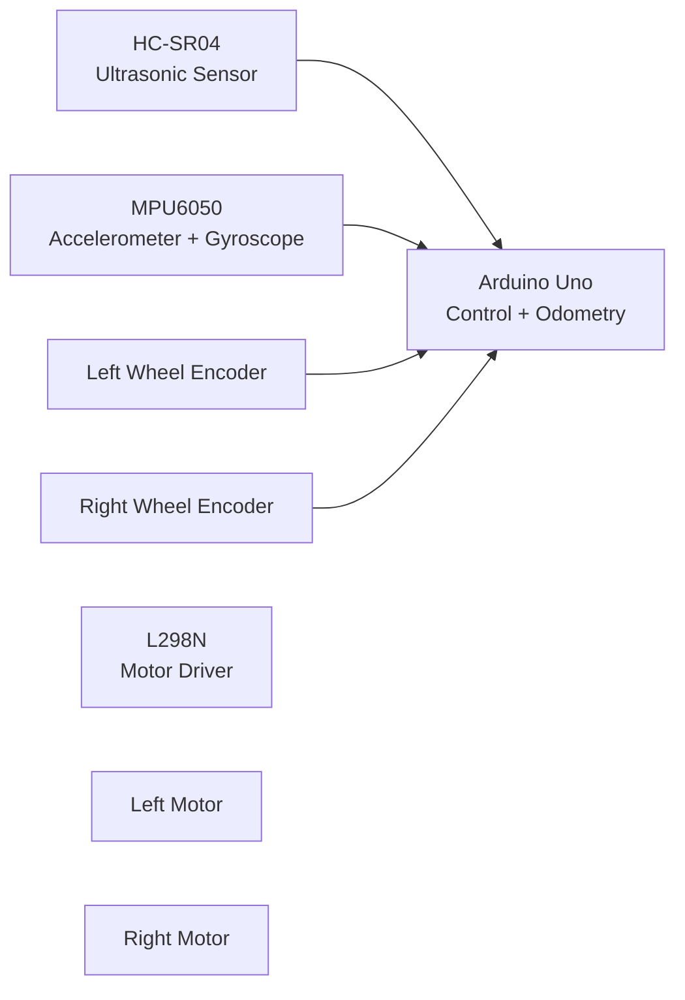

# Encoder-Feedback Differential-Drive Mobile Robot

## Overview

This project is an autonomous differential-drive mobile robot developed to explore embedded control, sensor integration, and mobile-robot motion.

The robot uses quadrature wheel encoders for feedback, independent PI wheel-speed control, differential-drive kinematics, and encoder-based odometry. An HC-SR04 ultrasonic sensor detects nearby obstacles, while an MPU6050 provides accelerometer and gyroscope measurements.

During autonomous operation, the robot drives forward under closed-loop wheel-speed control, detects an obstacle at approximately 20 cm, stops, performs an encoder-measured ~90° avoidance turn, and continues driving.

## Demo

## Key Features

- Dual quadrature encoder feedback for left and right wheel motion
- Independent PI wheel-speed control
- Differential-drive kinematics
- Encoder-based odometry estimating position and heading
- HC-SR04 ultrasonic obstacle detection
- MPU6050 accelerometer and gyroscope integration
- Autonomous obstacle-response behaviour
- Encoder-measured approximately 90° turning
- Real-time serial monitoring of RPM, pose and sensor data

## Hardware

- Arduino Uno R3
- L298N dual H-bridge motor driver
- 2 × geared DC motors with quadrature encoders
- HC-SR04 ultrasonic distance sensor
- MPU6050 accelerometer and gyroscope
- 2-wheel differential-drive chassis with passive caster
- 65 mm wheels
- AA battery pack for motor power
- Separate Arduino power supply for untethered operation

## Robot Parameters

| Parameter | Value |
|---|---:|
| Wheel diameter | 65 mm |
| Wheel radius, \(r\) | 0.0325 m |
| Wheelbase, \(L\) | 0.13 m |
| Encoder resolution | ~960 counts/rev |
| PI speed target | 20 RPM |
| Obstacle threshold | ~20 cm |
| Avoidance turn | ~90° |

## System Architecture

## Core Engineering

### Differential-Drive Kinematics

For wheel radius \(r\), wheelbase \(L\), and left/right wheel angular velocities \(\omega_L\) and \(\omega_R\):

$$
v = \frac{r}{2}(\omega_R + \omega_L)
$$

$$
\omega = \frac{r}{L}(\omega_R - \omega_L)
$$

where:

- \(v\) is the robot's linear velocity
- \(\omega\) is the robot's angular velocity

For this robot:

- \(r = 0.0325\text{ m}\)
- \(L = 0.13\text{ m}\)

---

### Encoder-Based Wheel Speed

Encoder counts are converted into wheel revolutions using:

$$
N_{rev} = \frac{N_{counts}}{CPR}
$$

Wheel speed in RPM is then calculated from the number of revolutions measured over a sampling interval:

$$
RPM = \frac{N_{rev}}{\Delta t} \times 60
$$

The measured encoder resolution was approximately:

$$
CPR \approx 960
$$

---

### PI Wheel-Speed Control

Each wheel uses independent closed-loop PI control:

$$
e(t) = RPM_{target} - RPM_{measured}
$$

$$
u(t) = K_p e(t) + K_i \int e(t)\,dt
$$

The controller adjusts the PWM command independently for each motor so that both wheels maintain approximately the same target speed despite differences between the motors and load.

---

### Encoder Odometry

Wheel encoder motion is converted into left and right wheel travel:

$$
\Delta s_L = r\Delta\phi_L
$$

$$
\Delta s_R = r\Delta\phi_R
$$

Robot displacement and heading change are estimated using:

$$
\Delta s = \frac{\Delta s_R + \Delta s_L}{2}
$$

$$
\Delta\theta = \frac{\Delta s_R - \Delta s_L}{L}
$$

The robot then updates its estimated planar pose:

$$
(x,\ y,\ \theta)
$$

    MCU -->|PWM + Direction| DRIVER

    DRIVER --> LM
    DRIVER --> RM

    LM --> ENC_L
    RM --> ENC_R
