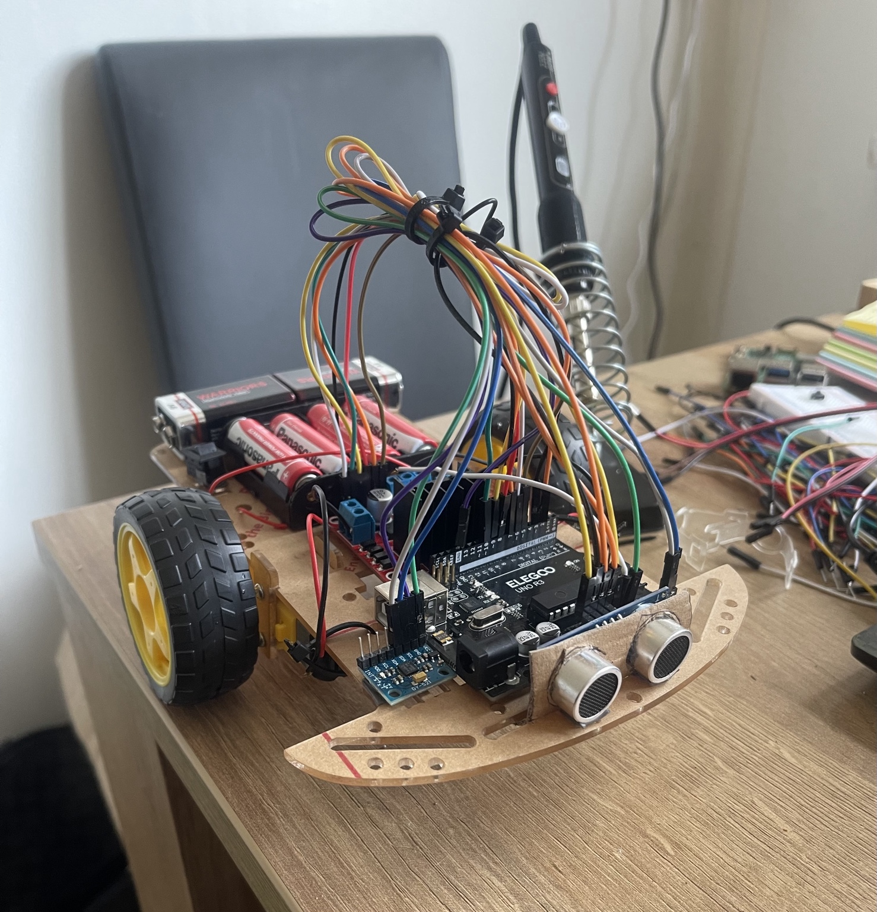
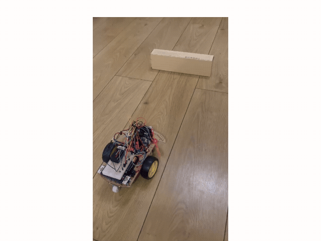
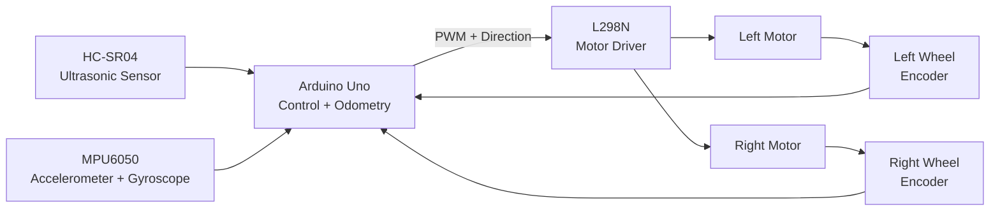

# Encoder-Feedback Differential-Drive Mobile Robot

## Overview

This project is an autonomous differential-drive mobile robot developed to explore embedded control, sensor integration, and mobile-robot motion.

The robot uses quadrature wheel encoders for feedback, independent PI wheel-speed control, differential-drive kinematics, and encoder-based odometry. An HC-SR04 ultrasonic sensor detects nearby obstacles, while an MPU6050 provides accelerometer and gyroscope measurements.

During autonomous operation, the robot drives forward under closed-loop wheel-speed control, detects an obstacle at approximately 20 cm, stops, performs an encoder-measured ~90° avoidance turn, and continues driving.

## Demo

## Key Features

- Dual quadrature encoder feedback for left and right wheel motion
- Independent PI wheel-speed control
- Differential-drive kinematics
- Encoder-based odometry estimating position and heading
- HC-SR04 ultrasonic obstacle detection
- MPU6050 accelerometer and gyroscope integration
- Autonomous obstacle-response behaviour
- Encoder-measured approximately 90° turning
- Real-time serial monitoring of RPM, pose and sensor data

## Hardware

- Arduino Uno R3
- L298N dual H-bridge motor driver
- 2 × geared DC motors with quadrature encoders
- HC-SR04 ultrasonic distance sensor
- MPU6050 accelerometer and gyroscope
- 2-wheel differential-drive chassis with passive caster
- 65 mm wheels
- AA battery pack for motor power
- Separate Arduino power supply for untethered operation

## Robot Parameters

| Parameter | Value |
|---|---:|
| Wheel diameter | 65 mm |
| Wheel radius, \(r\) | 0.0325 m |
| Wheelbase, \(L\) | 0.13 m |
| Encoder resolution | ~960 counts/rev |
| PI speed target | 20 RPM |
| Obstacle threshold | ~20 cm |
| Avoidance turn | ~90° |

## System Architecture

The control flow is:

**Sensors → Arduino → PI control / decision logic → motor driver → motors → encoder feedback**

The Arduino continuously measures wheel motion, estimates odometry, maintains wheel speed using PI control, and reacts to obstacles detected by the ultrasonic sensor.

## Core Engineering

### Differential-Drive Kinematics

For wheel radius $r$, wheelbase $L$, and left/right wheel angular velocities $\omega_L$ and $\omega_R$:

$$
v = \frac{r}{2}(\omega_R + \omega_L)
$$

$$
\omega = \frac{r}{L}(\omega_R - \omega_L)
$$

where:

- $v$ is the robot's linear velocity
- $\omega$ is the robot's angular velocity

For this robot:

- $r = 0.0325\,\text{m}$
- $L = 0.13\,\text{m}$

---

### Encoder-Based Wheel Speed

Encoder counts are converted into wheel revolutions using:

$$
N_{\text{rev}} = \frac{N_{\text{counts}}}{CPR}
$$

Wheel speed in RPM is calculated over a sampling interval $\Delta t$:

$$
RPM = \frac{N_{\text{rev}}}{\Delta t} \times 60
$$

The measured encoder resolution was approximately:

$$
CPR \approx 960\ \text{counts/rev}
$$

---

### PI Wheel-Speed Control

Each wheel uses independent closed-loop PI control.

The speed error is:

$$
e(t) = RPM_{\text{target}} - RPM_{\text{measured}}
$$

The controller output is:

$$
u(t) = K_p e(t) + K_i \int e(t)\,dt
$$

The controller adjusts the PWM command independently for each motor so that both wheels maintain approximately the same target speed despite differences in motor behaviour and load.

---

### Encoder Odometry

Wheel encoder motion is converted into left and right wheel travel:

$$
\Delta s_L = r\Delta\phi_L
$$

$$
\Delta s_R = r\Delta\phi_R
$$

The robot's centre displacement is:

$$
\Delta s = \frac{\Delta s_R + \Delta s_L}{2}
$$

The change in heading is:

$$
\Delta\theta = \frac{\Delta s_R - \Delta s_L}{L}
$$

These values are integrated to estimate the robot's planar pose:

$$
(x,\ y,\ \theta)
$$

## Results & Testing

### Encoder Calibration

Both wheel encoders were manually calibrated by rotating each wheel through one full revolution.

Measured values were approximately:

- Left wheel: ~965 counts/revolution
- Right wheel: ~969 counts/revolution

A working encoder resolution of approximately:

$$
CPR \approx 960
$$

was therefore used for wheel-speed and odometry calculations.

---

### Wheel-Speed Measurement

Encoder counts were converted into wheel speed in RPM and rad/s.

During initial open-loop testing, both wheels reached approximately:

- Left wheel: 38–39 RPM
- Right wheel: 38–39 RPM

The measured wheel angular velocity was approximately:

$$
\omega \approx 4.0\ \text{rad/s}
$$

---

### Closed-Loop Wheel-Speed Control

Independent PI controllers were implemented for the left and right motors.

The target wheel speed was:

$$
RPM_{\text{target}} = 20\ RPM
$$

After tuning, both wheels operated close to the target speed with independent PWM adjustment.

Typical measured values were approximately:

| Target | Left Wheel | Right Wheel |
|---|---:|---:|
| 20 RPM | ~20–22 RPM | ~20–22 RPM |

This demonstrated that encoder feedback could be used to regulate the two motors independently despite differences in motor behaviour.

---

### Odometry

Encoder-based differential-drive odometry was used to estimate:

- robot position $x$
- robot position $y$
- robot heading $\theta$

During straight-line bench testing, both wheels operated at approximately 20 RPM while the estimated heading remained close to zero, demonstrating consistent forward-motion estimation.

---

### Obstacle Avoidance

The HC-SR04 ultrasonic sensor continuously measured the distance in front of the robot.

The obstacle threshold was set to approximately:

$$
20\ \text{cm}
$$

When an obstacle was detected, the robot:

1. stopped
2. executed an encoder-measured approximately 90° right turn
3. stopped briefly
4. continued driving forward

The final autonomous floor test successfully demonstrated this complete behaviour.

---

### Final Demonstrated Behaviour

**Drive forward → detect obstacle → stop → turn ~90° → continue driving**

The final system combined:

- encoder feedback
- PI wheel-speed control
- differential-drive odometry
- ultrasonic obstacle sensing
- MPU6050 inertial sensing
- autonomous motion logic

    MCU -->|PWM + Direction| DRIVER

    DRIVER --> LM
    DRIVER --> RM

## Engineering Challenges & Debugging

### Motor Power Delivery

During early dual-motor testing, one motor occasionally slowed or stalled when both motors were commanded simultaneously.

The problem was traced primarily to weak batteries and insufficient available motor voltage/current under load. With degraded batteries, the PI controller saturated at the maximum PWM value while the motors were still unable to reach the requested speed.

Replacing the batteries restored normal motor performance and gave the controller sufficient authority to regulate wheel speed.

**Lesson:** control software cannot compensate for an actuator that has insufficient electrical power available.

---

### Motor Startup and Friction

One motor initially exhibited inconsistent startup behaviour despite operating correctly when tested individually.

The motor and gearbox showed some initial stiction, and manually rotating the wheel several times improved its behaviour.

A short startup PWM boost was also used before transitioning to normal closed-loop control.

---

### Encoder Direction Conventions

Because the left and right motors are mounted as mirrored assemblies, their encoder counts did not naturally use the same sign convention.

During forward motion:

- one encoder produced positive counts
- the other produced negative counts

The software therefore corrected the encoder signs so that forward wheel travel was treated consistently by the odometry calculations.

---

### Motor Direction and Differential Drive

Initial testing showed that identical electrical direction commands caused the two physically mirrored motors to rotate in different robot directions.

Each motor direction was therefore verified independently and the final motor-control convention was established so that both wheels produced physical forward motion when commanded forward.

---

### Wheel-Speed Mismatch

Applying the same PWM value to both motors did not guarantee identical wheel speeds because real DC motors have manufacturing differences, friction and load variation.

Independent PI wheel-speed controllers were therefore implemented using encoder feedback.

This allowed each motor to receive a different PWM command while maintaining approximately the same requested wheel speed.

---

### Straight-Line Bias

During the final floor test, the robot demonstrated a small directional bias.

This highlighted the limitations of wheel-encoder odometry and real-world differential-drive systems, including:

- wheel-speed mismatch
- tyre and floor interaction
- wheel-radius uncertainty
- wheel slip
- mechanical alignment

Future development could combine encoder odometry with MPU6050 inertial measurements to improve heading estimation.

    LM --> ENC_L
    RM --> ENC_R
