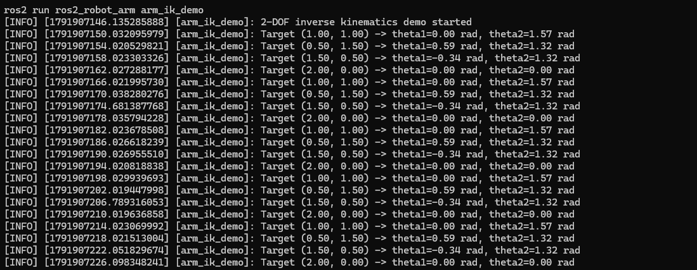

# ROS 2 Robot Arm Kinematics, Simulation and Control

A simulation-based 2-DOF robotic manipulator developed using ROS 2, Gazebo, RViz and `ros2_control`. The project combines robot modelling, kinematics, trajectory control, simulation, joint-state feedback and ROS 2 system integration into a reproducible robotics control system.


## Overview

This project was developed to connect robot kinematics theory with a complete ROS 2 simulation and control workflow.

A custom 2-DOF planar robot arm was modelled in URDF and simulated in Gazebo. The joints are controlled through `ros2_control` using a `JointTrajectoryController`, while joint-state feedback is published through a `JointStateBroadcaster`.

`robot_state_publisher` converts the measured joint states into TF transforms so the same simulated motion can be visualised in RViz.

A custom ROS 2 Python node was also developed to solve inverse kinematics for Cartesian end-effector targets and automatically convert the resulting joint angles into ROS 2 trajectory commands.

The complete project can be launched using a single ROS 2 launch file.

---

## Key Features

- Custom 2-DOF robotic arm model in URDF
- Revolute joint modelling and joint limits
- Visual, collision and inertial robot properties
- Gazebo physics simulation
- `gz_ros2_control` simulation interface
- `ros2_control` position command interfaces
- `JointStateBroadcaster`
- `JointTrajectoryController`
- Joint position and velocity feedback
- Multi-point joint trajectory execution
- ROS 2 `FollowJointTrajectory` action interface
- Robot TF tree generated using `robot_state_publisher`
- RViz visualisation of simulated joint motion
- Gazebo simulation clock integration using `/clock`
- Forward and inverse kinematics
- Jacobian analysis and singularity understanding
- Custom inverse-kinematics ROS 2 node
- One-command integrated ROS 2 launch system

---

## System Architecture

```mermaid
flowchart TD

    A["Cartesian Target (x, y)"] --> B["Inverse Kinematics Node"]
    B --> C["Joint Angles: theta1, theta2"]
    C --> D["JointTrajectory Message"]
    D --> E["JointTrajectoryController"]
    E --> F["ros2_control"]
    F --> G["gz_ros2_control"]
    G --> H["Gazebo Simulated Joints"]

    H --> I["Joint State Interfaces"]
    I --> J["JointStateBroadcaster"]
    J --> K["/joint_states"]
    K --> L["robot_state_publisher"]
    L --> M["TF"]
    M --> N["RViz"]

    H --> O["Gazebo Visualisation"]

 ```

### IK Node Output



## How to Run the Demo

After cloning the repository and building the `ros2_robot_arm` package, source the workspace:

```bash
cd ~/ros2_ws
source /opt/ros/jazzy/setup.bash
source install/setup.bash
```

Launch the complete robot-arm simulation:

```bash
ros2 launch ros2_robot_arm arm_sim.launch.py
```

This starts the integrated simulation stack, including:

- Gazebo
- simulation clock bridge
- robot state publisher
- 2-DOF arm model
- joint state broadcaster
- joint trajectory controller
- RViz

Then open a second terminal, source the workspace again:

```bash
cd ~/ros2_ws
source /opt/ros/jazzy/setup.bash
source install/setup.bash
```

Run the inverse-kinematics demo:

```bash
ros2 run ros2_robot_arm arm_ik_demo
```

The demo cycles through predefined Cartesian end-effector targets, calculates the corresponding joint angles using inverse kinematics, and sends the resulting joint trajectories to the `ros2_control` arm controller.

The demo source code can be viewed at:

```text
src/arm_ik_demo.py
```

The integrated simulation launch file is located at:

```text
launch/arm_sim.launch.py
```

## Results & Testing

The complete system was successfully tested from a clean clone of the GitHub repository.

Key results:

- ROS 2 package detected and built successfully using `colcon`
- Complete simulation launched using a single ROS 2 launch command
- Both `joint_state_broadcaster` and `arm_controller` activated successfully
- Joint trajectories executed correctly in Gazebo
- Gazebo and RViz remained synchronised through `/joint_states` and TF
- Cartesian IK targets were converted successfully into joint-angle commands
- The arm repeatedly reached the commanded IK configurations
- Controller reference and feedback positions matched with errors close to numerical zero
- `FollowJointTrajectory` action goals completed successfully
- Controller activation/deactivation behaviour was deliberately tested and verified

## Future Improvements

- Expand the arm beyond 2 DOF
- Add a gripper
- Integrate MoveIt 2
- Add collision-aware motion planning
- Add camera-based object detection
- Implement autonomous pick-and-place
- Transfer the system to a physical robot arm
