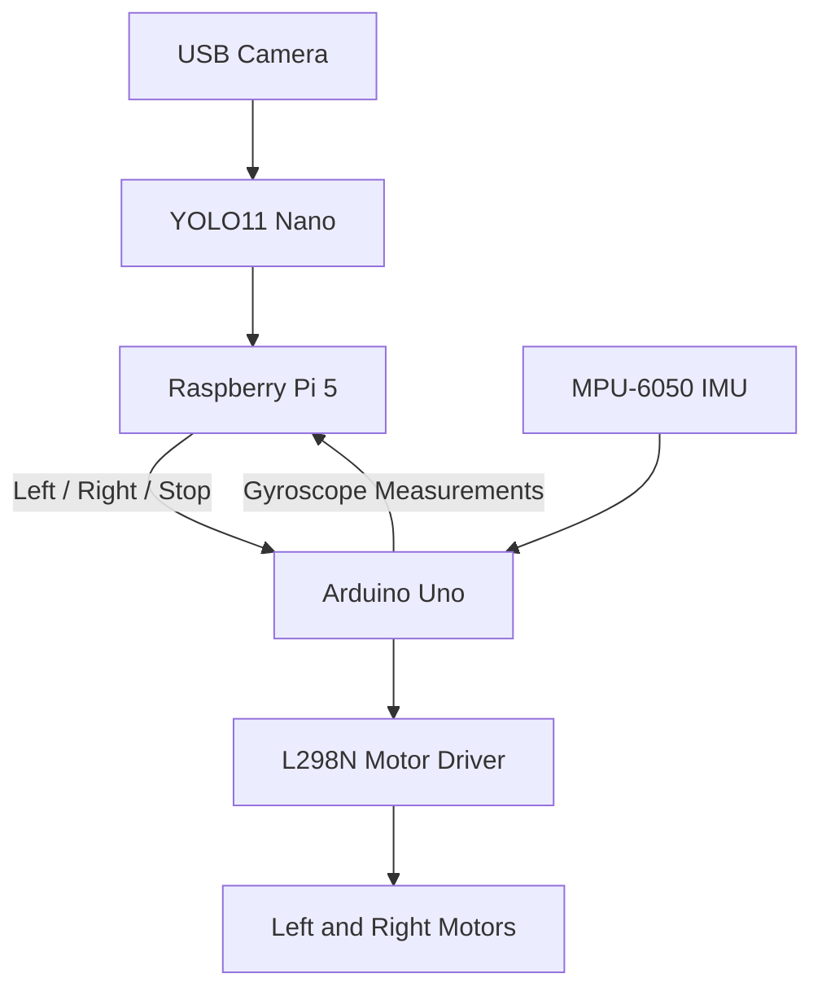

# Project 3 — Vision-Enabled Mobile Robot with YOLO Tracking & Visual SLAM
## Robot Demonstration

### YOLO Object-Tracking Demonstration

https://github.com/user-attachments/assets/36475e6b-3180-4a19-a5e8-d6a8b657e0e8

## Overview

Designed and implemented a vision-enabled differential-drive mobile robot integrating deep-learning-based object detection, embedded motor control and gyroscope sensing.

The physical robot uses a Raspberry Pi 5 running YOLO11 Nano to detect a person through a USB camera. Detection coordinates are converted into steering commands and transmitted to an Arduino Uno, enabling the robot to rotate towards and visually track the target.

A separate ROS 2 Jazzy and Gazebo simulation demonstrates RGB-D visual SLAM using RTAB-Map, including odometry integration, TF transformations and occupancy-grid mapping.

## Key Features

- Real-time object detection using YOLO11 Nano and OpenCV
- Raspberry Pi 5 to Arduino Uno communication over USB serial
- Rotation-only visual target tracking
- Pulse-based motor control to reduce overshoot and oscillation
- Automatic stopping when the target is centred or lost
- Motor-command watchdog for communication-loss protection
- GY-521 MPU-6050 angular-velocity measurements
- Simulated RGB-D SLAM using ROS 2 Jazzy, Gazebo and RTAB-Map
- 2D occupancy-grid mapping and RViz visualisation

## Hardware

| Component | Purpose |
|---|---|
| Raspberry Pi 5 | Object detection and high-level control |
| Arduino Uno | Low-level motor control and IMU interfacing |
| Logitech C270 webcam | RGB visual input |
| L298N motor driver | Differential-drive motor actuation |
| Two DC gear motors | Robot rotation |
| GY-521 MPU-6050 | Angular-velocity sensing |
| Differential-drive chassis | Mobile robot platform |

## Software and Technologies

Python, C++, OpenCV, YOLO11 Nano, PyTorch, Arduino CLI, Linux, USB serial communication, ROS 2 Jazzy, Gazebo Sim, RTAB-Map and RViz.

## System Architecture

The IMU was integrated for measurement and monitoring. The final physical tracking controller uses camera-position feedback rather than EKF-based sensor fusion.

## Visual Tracking Controller

The robot determines the target's horizontal position relative to the centre of the camera image.

- Target left of centre: rotate anticlockwise
- Target right of centre: rotate clockwise
- Target within deadband: stop
- Target not detected: stop

The controller uses short motor pulses followed by settling intervals to reduce oscillation caused by continuous rotation.

Final tested pulse-based settings:

| Parameter | Value |
|---|---|
| YOLO model | YOLO11 Nano |
| Inference image size | 320 pixels |
| Detection confidence threshold | 0.40 |
| Motor PWM | 125 / 255 |
| Tracking deadband | ±90 pixels |
| Rotation pulse | 0.15 s |
| Settling interval | 0.25 s |
| Serial watchdog timeout | 300 ms |

A separate continuous-rotation controller was also developed and tested.

## Visual SLAM Simulation

A differential-drive robot model was extended with a virtual RGB-D camera in Gazebo Sim.

RGB images, depth images, camera calibration and odometry were bridged into ROS 2 Jazzy and processed using RTAB-Map.

The simulated robot was manually driven through an obstacle environment while RTAB-Map generated a 2D occupancy map.

**The SLAM demonstration is simulation-only and was not deployed on the physical robot.**

## Results and Testing

- Successfully executed YOLO11 Nano inference on the Raspberry Pi 5 at approximately 100–108 ms per inference during initial tests.
- Demonstrated physical rotation-only tracking of a person.
- Verified automatic stopping when the target was centred or disappeared.
- Successfully communicated motor commands from the Raspberry Pi to the Arduino.
- Verified MPU-6050 gyroscope readings during robot rotation.
- Generated and visualised a simulated occupancy map using RTAB-Map.
- Saved the SLAM occupancy map and associated metadata.

## Engineering Challenges and Debugging

**Motor starting torque:** Low PWM initially caused one motor to remain stationary. Increasing PWM restored reliable actuation.

**Incorrect motor directions:** Physical testing revealed that the motor direction assumptions did not match the robot's wiring. The left/right command mapping was corrected.

**Tracking oscillation:** Continuous rotation produced overshooting and repeated corrections. A pulse-based control strategy improved tracking stability.

**Camera and SLAM performance:** Gazebo and RTAB-Map experienced reduced processing rates under WSL, together with RGB-D synchronisation delays.

**SLAM map quality:** The generated occupancy map contained streaking and overlapping boundaries. The simulation demonstrated mapping functionality but requires further tuning for accurate environmental reconstruction.

**RViz rendering:** An OpenGL rendering issue was resolved using software rendering.

## Future Improvements

- Closed-loop wheel-speed control using encoder feedback
- More advanced heading control using IMU measurements
- Improved RGB-D synchronisation and SLAM map quality
- Automated object-selection and multi-target tracking
- Greater onboard power independence and cable management
- Extended navigation and autonomous mobile manipulation

## Project Media and Source Code

Robot photographs, tracking demonstration, SLAM mapping results and implementation files will be organised within this project directory.
