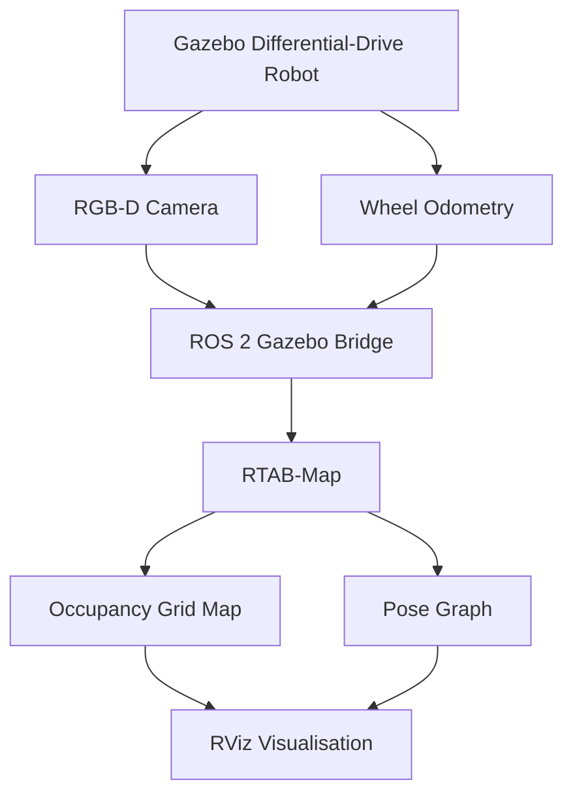

# Visual SLAM — ROS 2, Gazebo & RTAB-Map

## Overview

Implemented a simulation-based visual SLAM system using ROS 2 Jazzy, Gazebo Sim and RTAB-Map.

An existing differential-drive robot URDF was extended with a simulated RGB-D camera. Camera images, depth measurements and wheel odometry were integrated through ROS 2 to estimate the robot's trajectory and generate a 2D occupancy map.

The robot was manually driven through a Gazebo obstacle course while RTAB-Map processed sensor observations. Mapping results were visualised in RViz.

## System Architecture

## Implementation

- Extended the robot URDF with a camera mounting link and optical frame.
- Configured a simulated RGB-D camera at 640 × 480 resolution.
- Bridged RGB images, depth images, camera calibration and odometry into ROS 2.
- Established the required TF transformations between the robot and camera.
- Integrated RTAB-Map for RGB-D mapping using simulated wheel odometry.
- Controlled the robot using ROS 2 keyboard teleoperation.
- Generated and saved a 2D occupancy-grid map.

## Results

The system successfully produced a live occupancy map while the robot navigated through an obstacle course.

The resulting map used a resolution of 0.05 m per cell. Mapping was functional, although the generated occupancy grid contained streaking and overlapping obstacle boundaries.

## Engineering Challenges

**Simulation performance:** Gazebo and RTAB-Map ran at reduced processing rates under WSL.

**Sensor synchronisation:** RGB and depth messages experienced timestamp differences, reducing the rate of synchronised observations.

**RViz rendering:** An OpenGL rendering issue was resolved using software rendering.

**Mapping accuracy:** The occupancy grid demonstrated the mapping pipeline but requires further optimisation for accurate obstacle reconstruction.

## Scope

This SLAM implementation was performed entirely in simulation. The physical Raspberry Pi robot was used for YOLO-based object tracking, not physical SLAM.

## Files and Results

The robot URDF, Gazebo world configuration, saved map and screenshots are provided in this directory.
