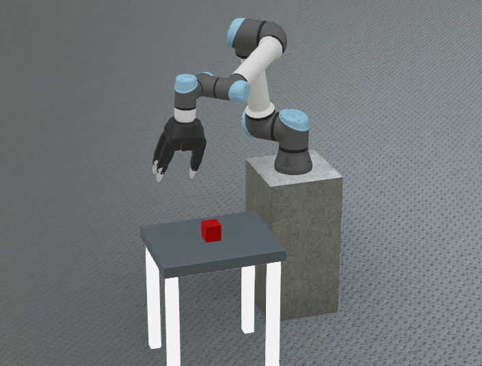
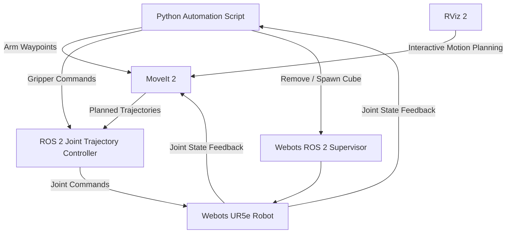
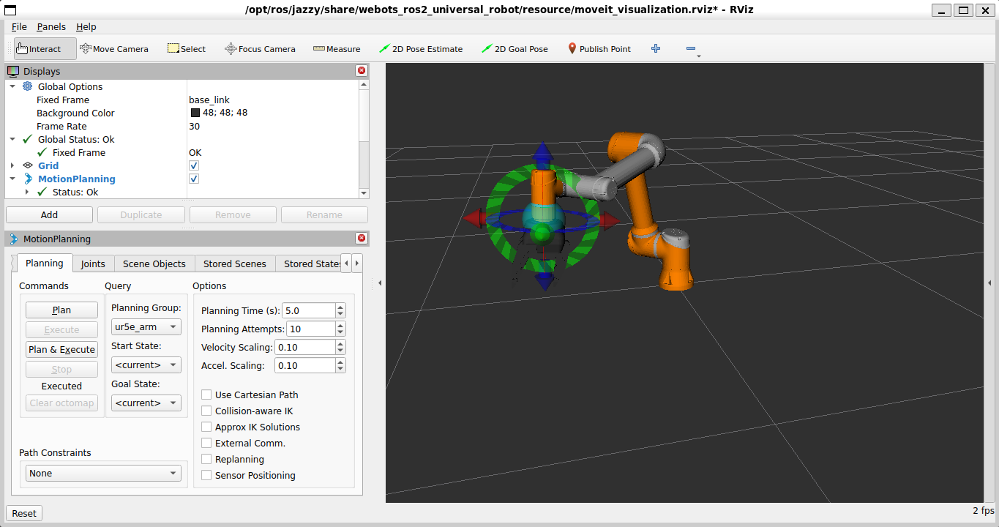

# Project 4 — UR5e Pick-and-Place Automation with ROS 2 and MoveIt 2

## Overview

This project demonstrates an automated pick-and-place workflow using a simulated UR5e robotic manipulator in Webots, integrated with ROS 2 Jazzy and MoveIt 2.

The system executes a five-stage motion sequence: approach, grasp, lift, place, and retreat. MoveIt 2 handles robot motion planning, while ROS 2 controllers execute joint trajectories and operate the gripper.

A simulation-assisted object transfer mechanism is used to represent picking and placing the cube, rather than relying on physical grasping and contact dynamics.

The project focuses on robotic manipulation, motion planning, trajectory execution, ROS 2 integration, and experimental validation.

## Key Features

- **ROS 2 Integration:** Communication between Webots, MoveIt 2, and robot controllers using ROS 2 Jazzy.
- **Motion Planning:** MoveIt 2 generates joint-space trajectories for the six-axis UR5e manipulator.
- **Waypoint-Based Automation:** Five recorded robot configurations define the approach, grasp, lift, place, and retreat sequence.
- **Gripper Control:** Automated opening and closing of the two-finger gripper through ROS 2 trajectory actions.
- **Simulation-Assisted Object Transfer:** Automated cube removal and respawning represents the pick-and-place operation without physical grasp simulation.
- **Trajectory Validation:** Actual joint positions are compared against commanded targets to evaluate execution accuracy.

## Software & Technologies

| Technology | Purpose |
|---|---|
| ROS 2 Jazzy | Robot communication and system integration |
| MoveIt 2 | Motion planning and trajectory generation |
| Webots R2025a | UR5e robot and workcell simulation |
| RViz 2 | Robot visualisation and interactive motion planning |
| ros2_control | Joint trajectory execution and gripper control |
| Python 3 | Automated pick-and-place sequence |
| Ubuntu 24.04 (WSL2) | ROS 2 development environment |

## System Architecture

The system integrates ROS 2, MoveIt 2, ros2_control, and Webots to perform automated manipulation using the UR5e robot.

### Control and Communication

1. **Python Automation:** Coordinates the five recorded waypoints and gripper actions.
2. **MoveIt 2:** Plans robot arm trajectories between saved joint configurations.
3. **ros2_control:** Executes commanded joint trajectories and controls the gripper fingers.
4. **Webots:** Simulates the UR5e manipulator and workcell.
5. **Joint Feedback:** Actual joint positions are monitored to verify execution accuracy.
6. **ROS 2 Supervisor:** Handles discrete cube removal and respawning to simulate object transfer.

## Robot Kinematics & Motion Planning

### 1. Robot Joint Configuration

The UR5e is a six-degree-of-freedom (6-DOF) serial manipulator. Its configuration is represented by six revolute joint angles:

$$
\mathbf{q} =
\begin{bmatrix}
q_1 & q_2 & q_3 & q_4 & q_5 & q_6
\end{bmatrix}^{T}
$$

These correspond to the shoulder pan, shoulder lift, elbow, and three wrist joints.

### 2. Forward Kinematics

The end-effector pose is determined by the robot's joint configuration:

$$
T_0^6(\mathbf{q}) = T_0^1(q_1)T_1^2(q_2)\cdots T_5^6(q_6)
$$

Each homogeneous transformation represents the position and orientation relationship between adjacent links.

MoveIt 2 uses the robot model and kinematic information to plan movements between target configurations.

### 3. Motion Planning

Five joint-space waypoints were recorded through RViz:

1. **Approach:** Position the open gripper above the cube.
2. **Grasp:** Position the fingers around the cube.
3. **Lift:** Raise the manipulator clear of the table.
4. **Place:** Move to the destination above the table.
5. **Retreat:** Move the gripper away from the placement location.

MoveIt 2 generates trajectories between the saved joint configurations. The ROS 2 joint trajectory controller executes the commanded movements in Webots.

### 4. Joint Position Error

Trajectory execution was evaluated by comparing commanded and measured joint positions.

For each joint:

$$
e_i = |q_{i,\mathrm{target}} - q_{i,\mathrm{actual}}|
$$

The maximum final joint error was calculated as:

$$
e_{\max} = \max_{i=1,\ldots,6}(e_i)
$$

During successful trials, maximum final joint errors were approximately **0.02–0.03 rad**, demonstrating close agreement between commanded and measured final joint configurations.

### MoveIt 2 Motion Planning

## Experimental Results & Testing

### 1. Automated Motion Sequence

The UR5e successfully executed all five programmed waypoints using MoveIt 2 and ROS 2 trajectory controllers.

| Stage | Maximum Final Joint Error | Result |
|---|---|---|
| Approach | 0.023 rad | Successful |
| Grasp | 0.016 rad | Successful |
| Lift | 0.023 rad | Successful |
| Place | 0.024 rad | Successful |
| Retreat | 0.025 rad | Successful |

These measurements were obtained from a successful motion-only validation run with the gripper kept open.

The complete five-stage motion test took approximately **38.8 seconds**.

### 2. Gripper Testing

The two-finger gripper was tested using ROS 2 FollowJointTrajectory actions.

- Open position: 0.10 rad per finger joint
- Closed position: 0.63 rad per finger joint
- Both opening and closing commands were successfully executed.

### 3. Lift Trajectory Investigation

During initial testing, the robot repeatedly failed to reach the LIFT waypoint with the gripper closed around the stationary cube.

Maximum final joint errors of approximately **0.32–0.35 rad** were recorded.

To investigate the issue, the same trajectory was executed with the gripper open. The robot successfully completed the LIFT movement with a final joint error of **0.023 rad**.

This indicated that the failure was associated with the closed-gripper interaction rather than an unreachable arm waypoint.

### 4. Final Demonstration

A simulation-assisted object transfer was implemented to avoid the limitations of grasping a stationary cube.

The final demonstration successfully executed:

1. Approach the cube.
2. Position the gripper around the cube.
3. Simulate object pickup.
4. Raise the manipulator.
5. Move to the placement position.
6. Simulate object release at the destination.
7. Retreat to a safe position.

The demonstration validated the integrated automation sequence, although physical grasp forces and object transport were not simulated.

## Demonstration

https://github.com/user-attachments/assets/6bd1ae24-08c6-45e2-adf0-7a51926792d7

