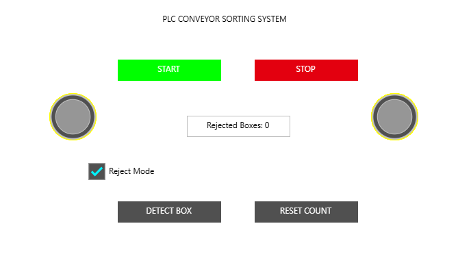
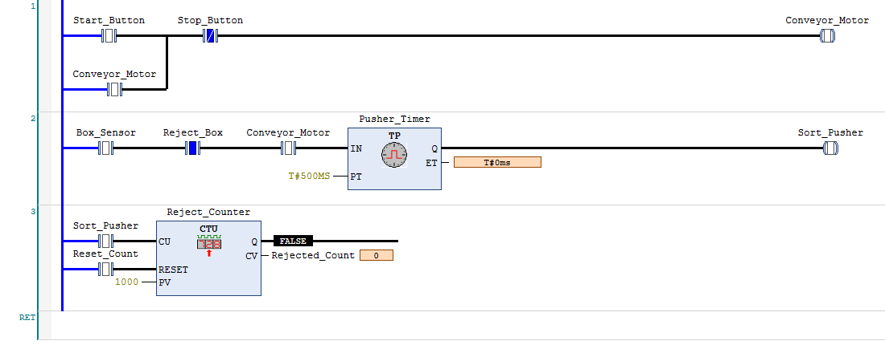

# PLC-Based Automated Conveyor Sorting System

## Overview

A simulated industrial conveyor sorting system developed using **CODESYS V3.5 and IEC 61131-3 Ladder Logic (LD)**.

The project demonstrates fundamental PLC programming techniques used in industrial automation, including motor control, sensor-based sequencing, timer function blocks, counters and operator interfaces.

The system detects simulated boxes and activates a timed sorting pusher when reject mode is enabled. A custom Human–Machine Interface (HMI) allows operators to control and monitor the process.

## Key Features

- **Start/Stop Motor Control:** Self-latching conveyor motor circuit with stop priority.
- **Sensor-Based Sorting:** Virtual box detection and selectable reject mode.
- **Timed Actuation:** TP pulse timer controlling a simulated sorting pusher for 500 milliseconds.
- **Production Counter:** CTU counter tracking rejected-box events, with manual reset.
- **Operator HMI:** Interactive controls, status indicators and a live rejected-box counter.
- **PLC Simulation:** Developed and tested without physical PLC hardware.

## Software and Technologies

| Technology | Application |
|---|---|
| CODESYS V3.5 SP22 | PLC development and simulation |
| Ladder Logic (LD) | Industrial control programming |
| TP Function Block | Timed sorting actuator |
| CTU Function Block | Rejected-box counting |
| CODESYS Visualization | Interactive operator HMI |
| IEC 61131-3 | PLC programming standard |

## System Architecture

The simulated system follows this control sequence:

**Operator Start → Conveyor Motor → Box Detection → Reject Decision → TP Timer → Sorting Pusher → CTU Counter**

The HMI allows the operator to start or stop the conveyor, select reject mode, simulate box detection, monitor system status and reset the production count.

## PLC Ladder Logic Implementation

### Network 1 — Conveyor Motor Control

Implements a self-holding Start/Stop circuit using normally open and normally closed contacts.

The motor remains active after the Start button is released and stops when the Stop button is activated. Releasing Stop does not automatically restart the conveyor.

### Network 2 — Automated Sorting

Three conditions enable a sorting event:

1. Box sensor detects an object.
2. Reject mode is enabled.
3. Conveyor motor is running.

A TP timer generates a 500 ms output pulse to activate the simulated sorting pusher.

### Network 3 — Rejected-Box Counter

A CTU function block increments the rejected-box count on each rising edge of the sorting pusher signal.

The count can be reset through the HMI. The counter preset is configured to 1000.

## Results and Testing

The PLC control logic was compiled and tested in CODESYS simulation.

| Test | Result |
|---|---|
| Conveyor starts when commanded | Passed |
| Motor remains running after Start is released | Passed |
| Stop command deactivates the motor | Passed |
| Motor remains stopped after Stop is released | Passed |
| Reject detection triggers the pulse timer | Passed |
| Rejected-box counter increments | Passed |
| HMI controls conveyor operation | Passed |
| Counter reset returns value to zero | Passed |

The system successfully counted two simulated rejected boxes before resetting the counter to zero.

## Demonstration

https://github.com/user-attachments/assets/3f59bbcc-ffc6-4279-8080-73bcb17af916

The demonstration shows the HMI controlling the conveyor, enabling reject mode, detecting boxes, updating the rejected-box count and stopping the process.

## Engineering Challenges

**PLC Sequencing and Latching:** Implemented motor self-holding logic to maintain conveyor operation without continuously pressing Start.

**Timed Output Control:** Integrated a TP timer to limit the sorting actuator command to a defined pulse duration.

**Event-Based Counting:** Used a CTU counter to count distinct sorting pulses instead of repeatedly incrementing on every PLC scan.

**HMI Integration:** Configured interactive visualization elements and linked them to PLC variables for real-time operation and monitoring.

## Limitations and Future Improvements

The system is a PLC logic and HMI simulation, rather than a physical or animated conveyor system.

Potential extensions include:

- Automatic box classification using physical sensors.
- Jam detection, fault interlocks and alarm handling.
- Automatic/manual operating modes.
- Integration with physical PLC I/O and conveyor hardware.
- A visual conveyor animation or factory digital twin.
- Hardware-level functional safety and emergency-stop integration.

## Project Files

- [CODESYS Project File](src/PLC_Conveyor_Sorting.project)
- [Ladder Logic Screenshot](media/ladder_logic.png)
- [HMI Screenshot](media/plc_conveyor_sorting_system.png)
- [Demonstration Video](media/plc_conveyor_demo.mp4)

## Conclusion

This project demonstrates foundational industrial PLC programming and control-system design through a functioning simulated conveyor sorting application.

It complements my mechanical engineering and robotics background by providing practical experience with Ladder Logic, industrial control sequences, timers, counters, simulation and operator-interface development.
